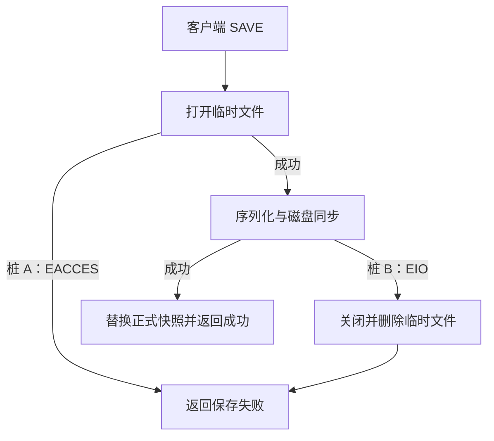

# Redis Linux 实项目验收系统

目标是以真实 Linux 服务验证源码分析、用例、代码修改、构建产物和运行现象之间的对应关系。无需容器。首个目标为 redis/redis 7.2.7，固定提交 `ba181057223b04aba580a01b1b36662430aea4a0`。

当前有两个入口：默认执行本轮助手阅读实际源码后形成的参考修改；传入 `--edits-from` 时执行 PANGEA 打桩任务保存的 `generation/authored-result.json` 中的实际 edits。参考修改不是 PANGEA 自动分析的验收结果。真实外部执行器未接入时，不生成虚假的 Run 或完成状态。

## 流程与用例

基线源码 `src/rdb.c:3621` 的 `saveCommand` 调用 `rdbSave`（1516），再进入 `rdbSaveInternal`（1445）。打开临时文件后进行 RDB 序列化、刷新、同步和关闭，最后替换正式快照。打开失败直接返回；同步失败进入原有 werr，关闭并删除临时文件。



| 场景 | 操作和判定 |
| --- | --- |
| 桩关闭 | SET、SAVE 成功，重启后 GET 返回保存值 |
| A：打开失败 | 第一次 SAVE 返回错误，A 命中一次；旧快照不变，内存数据仍可读 |
| B：同步失败 | 第一次 SAVE 返回错误，B 命中一次；临时文件被清理，旧快照不变 |
| A+B | 第一次只命中 A，证明 B 被前序返回阻断；第二次 A 已耗尽，B 命中；第三次成功 |
| 恢复 | 单桩耗尽后 SAVE 成功；关闭桩重启，数据可恢复并再次保存 |

生成代码约定：`PANGEA_FI_RDB` 未设置或为空时全部关闭；A/B/AB 选择桩，每桩每个进程只触发一次。日志分别包含 `PANGEA_FI hit=A` 与 `PANGEA_FI hit=B`。触发前设置变量并启动服务，撤桩清空变量后重新启动。仅制造 fopen/fsync 故障，保留原有错误处理和清理逻辑。

## 自动执行

在 Linux 安装已有工程工具 Git、make、C 编译器、Python 3.12+。准备上述固定版本源码，运行：

```bash
python plugins/dsh-pangea-companion/scripts/accept-redis-linux.py \
  --source /absolute/path/to/redis \
  --work /absolute/path/to/new-acceptance-directory
```

验证真实 PANGEA 生成修改时，增加 `--edits-from /absolute/path/to/generation/authored-result.json`。此验收场景限于 src/rdb.c，模型需要按上述控制约定实现修改。脚本不会替模型补代码；原文不匹配、编译失败、桩未命中或业务判定失败均保留失败记录。

在已配置好 Codex CLI 的 Linux 主机也可增加 `--analyze-with-codex`，自动先执行只读源码分析并保存 Agent 事件和输出，再进入构建验证。该参数与 `--edits-from` 互斥。分析指令保存在 `scripts/redis-analysis-prompt.txt`，包含场景目标和可观察控制合同，不包含参考补丁。

系统自动构建基线、建立独立 Git 副本及分支、应用修改并提交、构建 tar.gz、解包部署、选择本机回环端口、启动真实 Redis、发送 RESP 请求、核对日志和快照哈希、停止自己启动的进程。每个模式使用独立数据目录；原源码不打桩。没有向 Redis 上游推送的步骤。

每轮保存 report.json、edits.json、source.diff、两次构建日志、构建包及 SHA256、逐场景服务日志和 RDB 文件。验收报告记录基线与修改提交，只有所有断言通过才标记 passed。构建包用于当前 Linux 架构和运行库环境，不宣称跨发行版通用。

## PANGEA 全链路接入边界

### 2026-11-14 实测结果

当前会话独立 Agent 只读取原始 Redis 源码和控制合同，自行生成 `docs/redis-agent-analysis.json`，没有读取参考补丁。使用该文件真实执行构建、打包、解包、服务启动和 RESP 用例，四组 off/A/B/AB 全部通过。结果保存在 `docs/redis-acceptance-result.json`，包含源码提交、生成结果哈希、构建包哈希及命中日志证据。AB 首次 SAVE 验证只有 A 命中，第二次 B 命中，第三次成功；所有模式均完成关闭桩、重启及数据恢复检查。

待接入的实际链路为：真实外部 Agent 执行源码流程分析，产出 Run 和用例 → 用例页启动打桩任务 → 获取实际生成记录 → 本脚本构建部署与验证。当前环境未安装 NGA、CodeAgent 或 OpenCode。Codex CLI 显示已登录，但普通和 ephemeral 两次执行均在初始化报 `failed to initialize in-process app-server client: Read-only file system (os error 30)`，没有产生分析结果。当前会话的独立 Agent 可以作为真实源码分析执行器；它不是 PANGEA ACP 会话，不代替 Desktop 派发链路验收。接口固定数据测试、参考方案实项目测试和真实 Agent 产物验证分别记录。
